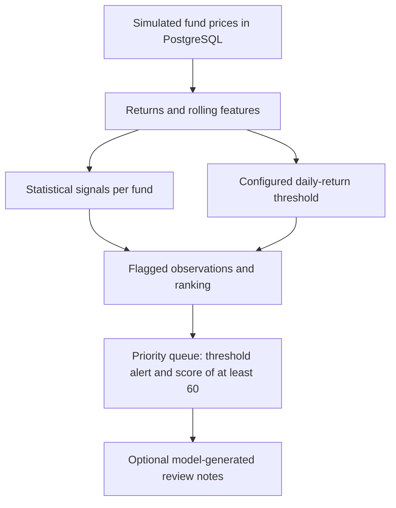

# Fund NAV Anomaly Detection

Which daily fund prices need a second look? This project simulates daily net asset values (NAVs) for ten funds, records unusual movements and statistical alerts in PostgreSQL, and ranks observations for analyst review.

## One alert

Think of this as the first row an analyst opens. The simulated LUX Mixed Conservative Fund rose 2.58% on 19 August 2024. The next step is to compare the move with the benchmark and check the pricing inputs.

| Observation | Value |
| --- | ---: |
| Daily return | +2.58% |
| Configured daily-return threshold | 0.50% |
| Priority score | 81.36 / 100 |
| Priority queue | Yes |

## One run

| Stage | Observations |
| --- | ---: |
| Simulated daily fund prices across 10 funds | 7,830 |
| Eligible after the rolling-history requirement | 7,640 |
| Flagged by at least one method | 2,029 |
| Crossed a configured daily-return threshold | 1,840 |
| Threshold alerts meeting the priority rule | 95 |

The detector measures daily price changes. A large change can reflect a genuine market move or a bad input. CSSF Circular 24/856 §4.2 addresses the size of a NAV calculation error relative to NAV. These simulated alerts support triage and analyst review. [CSSF Circular 24/856](https://www.cssf.lu/wp-content/uploads/CSSF24_856eng.pdf)

## How the pipeline works



- PostgreSQL stores the fund reference data in `dim_fund` and one observation per fund and date in `fact_nav_pricing`. The simulation includes stale prices and large price shifts.
- The detector scores the available history of each fund. It combines a return z-score with Isolation Forest and Local Outlier Factor, which use daily return, rolling volatility, tracking error and drawdown. The 0–100 score ranks cases for review.
- `fact_anomalies` keeps each alert and its scores. The optional Groq step adds suggested checks for priority cases. A missing or invalid response leaves the note pending.

[Database schema](database/schema.sql) · [Feature calculations](feature_engineering/compute_features.py) · [Detector](ml_models/anomaly_detection.py) · [Review notes](llm/generate_rationale.py)

## Run detection locally

Use Python 3.12 and an empty UTF-8 PostgreSQL database dedicated to this demo. From the repository root, create and activate a virtual environment, install the pinned packages, then copy `.env.example` to `.env` and fill in the local database settings. Keep your local credentials in `.env`.

```bash
python -m venv nav_env
# macOS/Linux: source nav_env/bin/activate
# PowerShell: .\nav_env\Scripts\Activate.ps1
python -m pip install -r requirements.txt
python -m pipeline.run_pipeline --detect-only
python -m pytest -q -k "not rationales"
```

Supply `GROQ_API_KEY` and omit `--detect-only` to request optional rationale generation. Treat generated explanations as suggestions for review.

The [original Power BI workbook](dashboard/nav_dashboard.pbix) and [presentation](NAV-Anomaly-Intelligence-Platform.pdf) use “breach” for simulated daily-return alerts. The case and counts above use the current definitions. In the PostgreSQL schema, legacy fields such as `is_cssf_breach` and `cssf_threshold` still carry the daily-return flag and threshold.
